# Bank of the Future

An online banking web app built with PHP and MySQL. Customers can open checking and savings accounts, move money, use a virtual ATM and deposit checks by photo. Employees get a back office for reviewing deposits, answering support tickets, and hiring or terminating staff.

> This is an educational project, not a real bank. Don't enter real personal information.

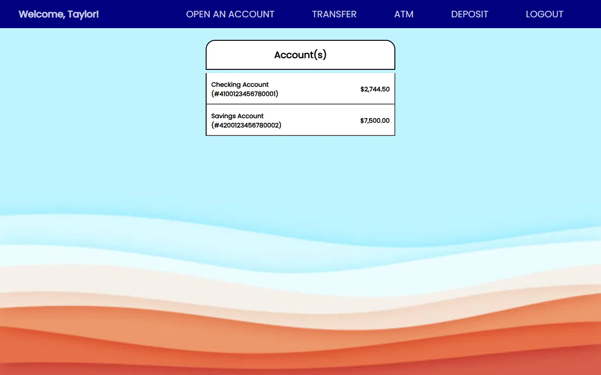

## Screenshots

| | |
|---|---|
| 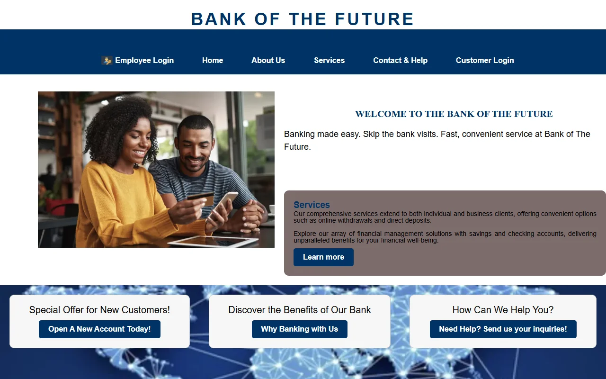 <br> **Public site** | 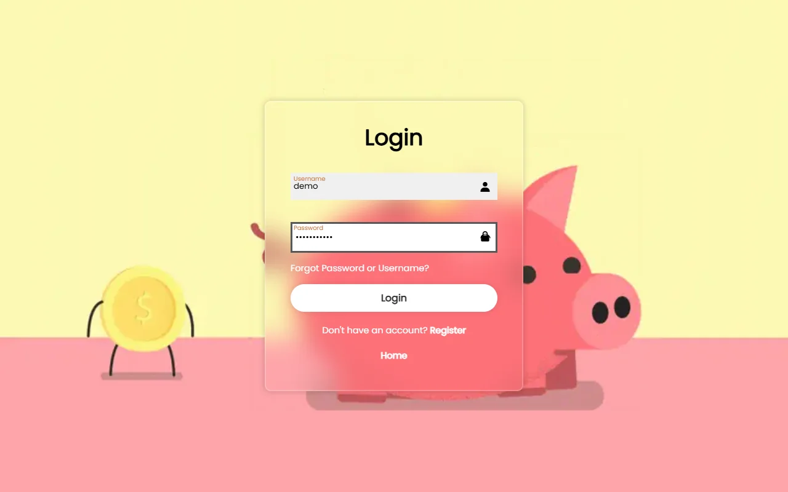 <br> **Customer login** |
| 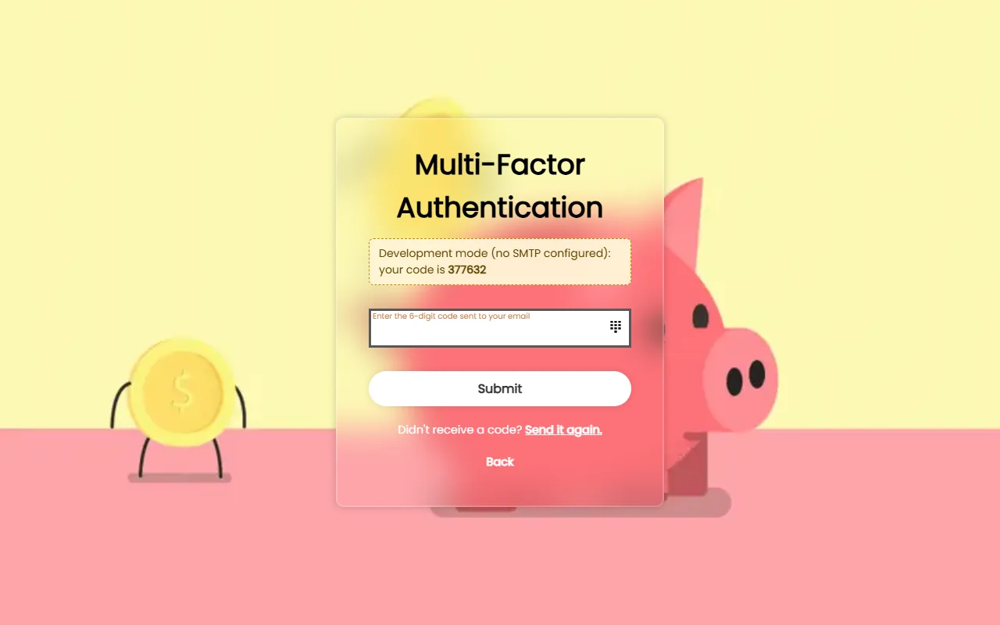 <br> **Emailed one-time code** (shown on screen in dev mode) | 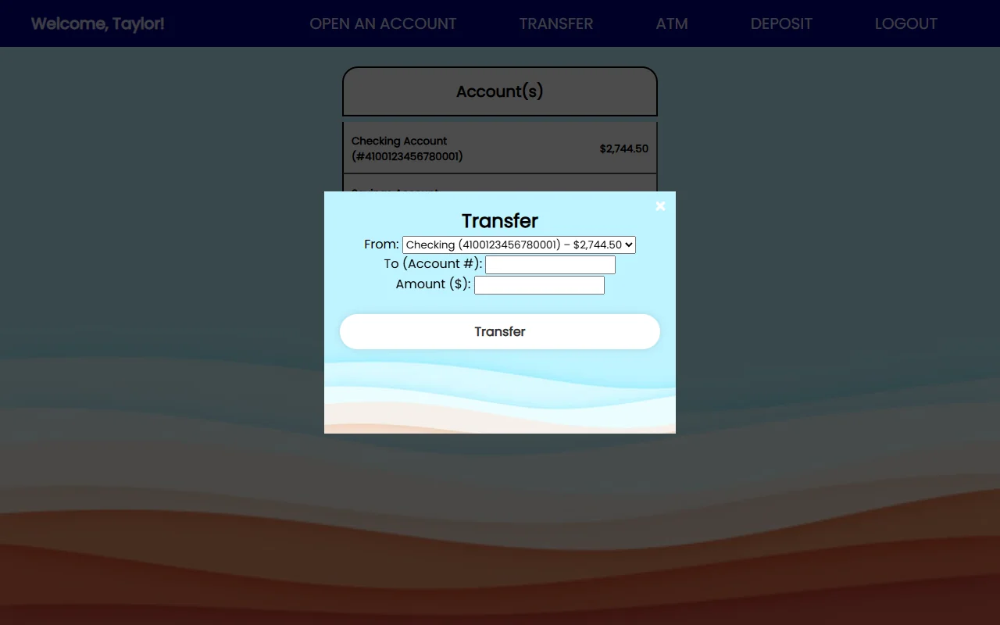 <br> **Transfers** |
| 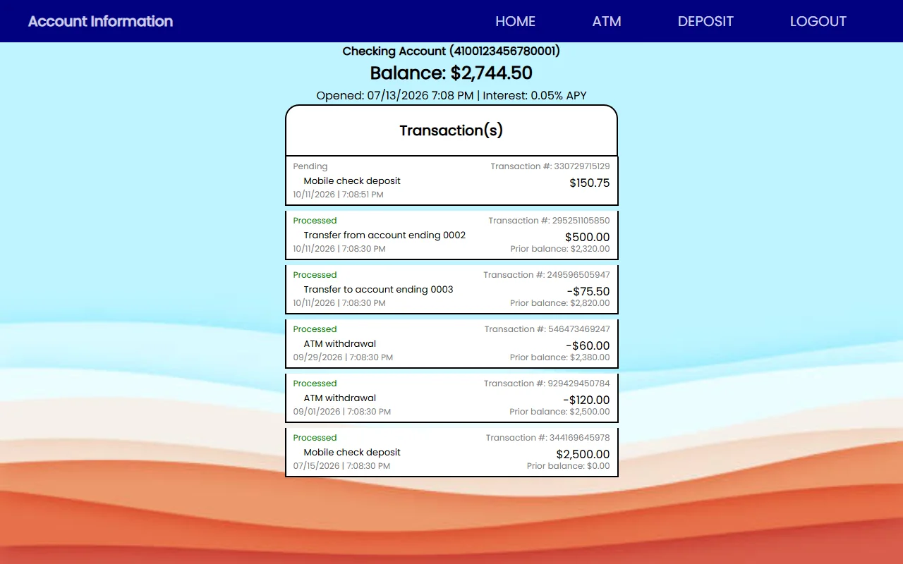 <br> **Account history** | 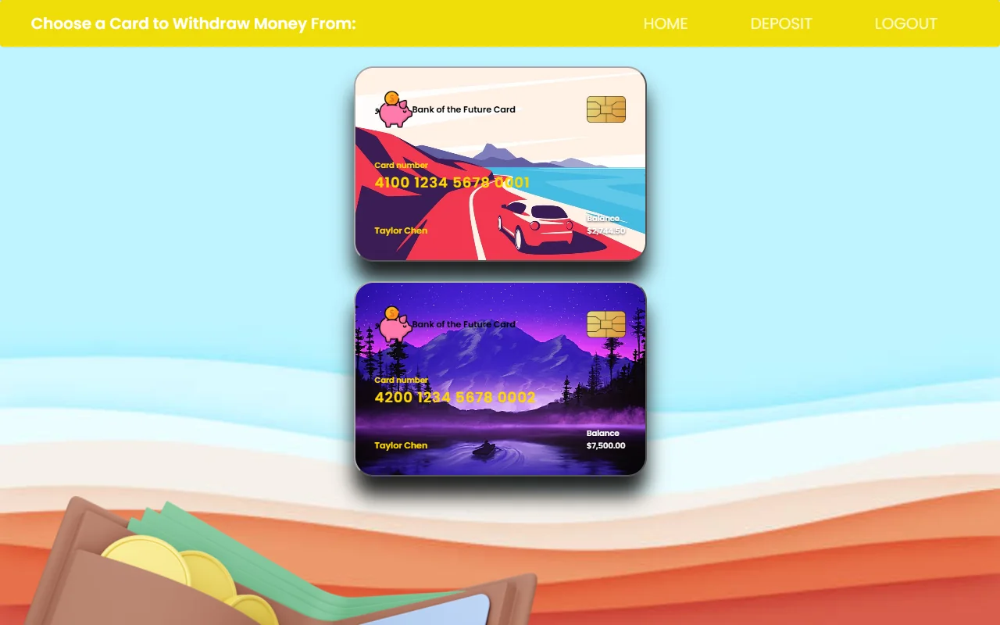 <br> **Virtual ATM** |
| 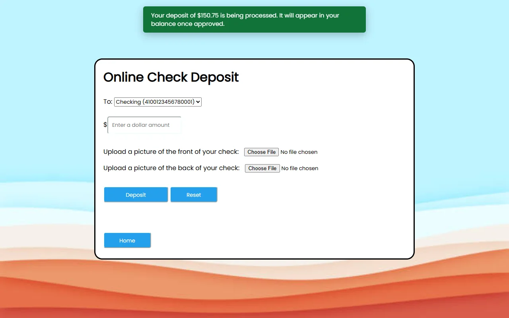 <br> **Mobile check deposit** | 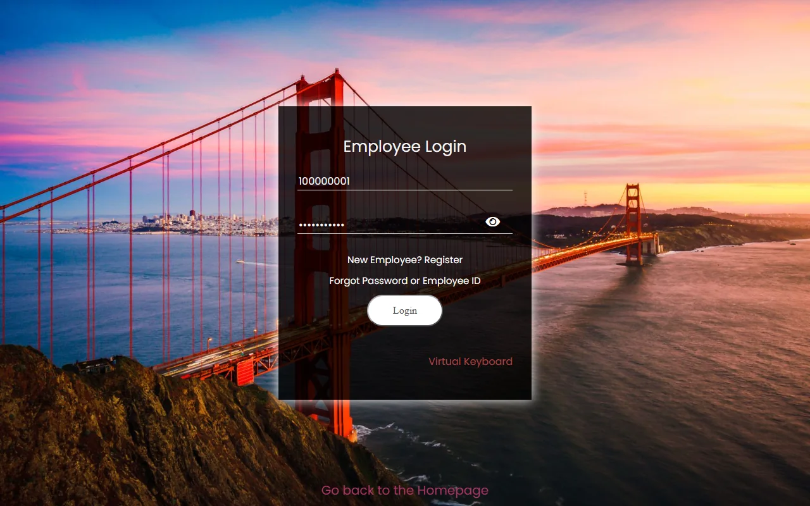 <br> **Employee login with on-screen keyboard** |
| 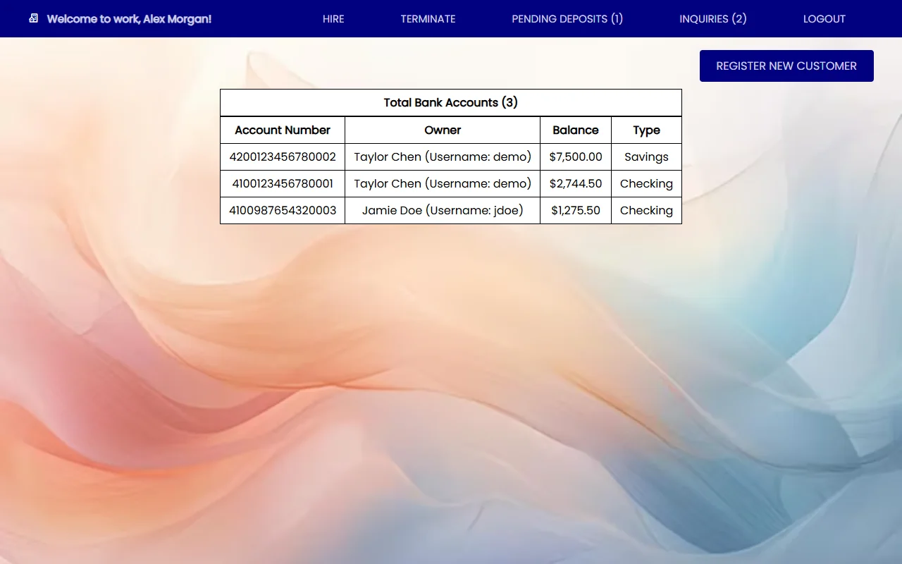 <br> **Employee dashboard** | 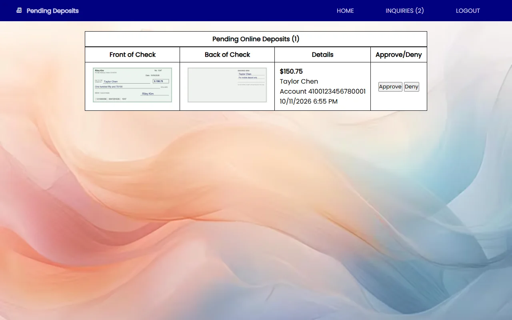 <br> **Deposit review** |
| 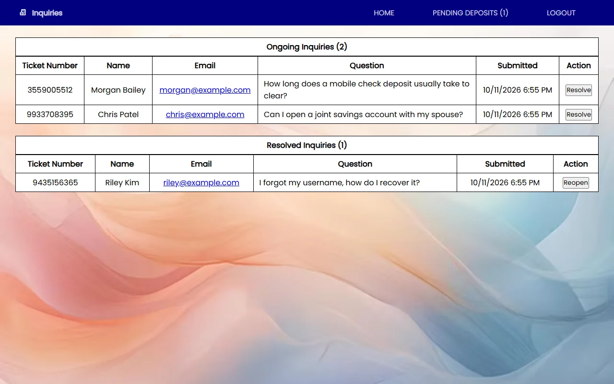 <br> **Support tickets** | |

## Features

**Customers**
- Registration, then login with a password plus a 6-digit code sent by email
- Checking (0.05% APY) and savings (0.57% APY) accounts. Interest compounds yearly and is posted as a transaction
- Instant transfers between your own accounts. Transfers to another customer need a second emailed code
- Virtual ATM: pick a debit card, enter your 4-digit PIN and withdraw
- Mobile check deposit: upload the front and back of a check. The deposit stays pending until an employee approves it
- Full transaction history per account
- Password reset and username recovery by email
- Logout after 10 minutes of inactivity, with a warning at 5 minutes

**Employees**
- Login with employee ID, password and an emailed code. An optional on-screen keyboard is available
- View every account, approve or deny check deposits, and resolve or reopen support tickets
- Tiered roles: tellers (1), managers (2) and admins (3). Managers and admins can hire into lower tiers, and new hires register with the employee ID from their offer email
- Managers can terminate their own hires and admins can terminate anyone below them. Access is revoked on the terminated employee's next request

## Quick start

**Requirements:** PHP 8.1+ (with `pdo_mysql` and `fileinfo`) and MySQL 8 or MariaDB 10.5+. PHPMailer is already included in `vendor/`, so Composer is optional.

```bash
git clone https://github.com/dumly55/Banking-Platform.git
cd Banking-Platform
cp .env.example .env              # then set DB_USER / DB_PASS if yours differ
php database/setup.php --seed     # creates the database, tables and demo data
php -S localhost:8000 -t public   # open http://localhost:8000
```

**Using XAMPP/WAMP/MAMP?** Clone into `htdocs` and open `http://localhost/Banking-Platform/public/`. All links are relative, so the app also works from a subfolder. Run the setup command with XAMPP's PHP, for example `C:\xampp\php\php.exe database\setup.php --seed`.

`setup.php` won't overwrite a database that already has tables. To wipe and recreate everything, run `php database/setup.php --fresh`.

### Demo accounts

Every demo account uses the password **`Password123`**.

| Role | Login | Notes |
|---|---|---|
| Customer | `demo` | PIN `1234`. Has a checking and a savings account |
| Customer | `jdoe` | PIN `4321`. Use checking account `4100987654320003` to test transfers to another person |
| Admin (tier 3) | employee ID `100000001` | Can hire and terminate anyone below tier 3 |
| Manager (tier 2) | employee ID `100000002` | Can hire tellers and terminate their own hires |
| Teller (tier 1) | employee ID `100000003` | Reviews deposits and tickets |
| New hire | employee ID `100000004` + `newhire@bankofthefuture.test` | Not registered yet. Try it at *Employee Login → New Employee? Register* |

### Email and verification codes

If `SMTP_HOST` is empty (the default), emails are not sent. They are appended to `storage/logs/mail.log` instead, and the verification page shows the code so you can log in locally without a mail server.

To send real email, fill in the SMTP settings in `.env`. For Gmail, use `smtp.gmail.com`, port `587`, and an [App Password](https://support.google.com/accounts/answer/185833). Set `APP_ENV=production` when you deploy so codes and error details are never shown on screen.

## Project structure

```
public/            Web root: the only folder the web server should expose
  *.php            One file per page. Each handles its own form submission
  *.html           Static marketing pages
  assets/          CSS, JS and images
src/               Application code (not web-accessible)
  bootstrap.php    Loaded by every page: config, session, security headers
  config.php       Reads settings from .env / environment variables
  db.php           PDO connection and query helpers
  auth.php         Sessions, login checks, inactivity timeout
  mfa.php          Emailed one-time codes
  banking.php      Accounts, transfers, withdrawals, deposits, interest
  validation.php   Form validation shared by customer and employee sign-up
  mail.php         PHPMailer wrapper (or log file in development)
  views/           Shared partials: navigation, flash messages, timeout dialog
database/
  schema.sql       Table definitions
  setup.php        Creates the database and optionally seeds demo data
storage/           Uploaded check images and the mail log (git-ignored)
tests/smoke.sh     End-to-end test suite
```

## Security

- All SQL uses prepared statements
- Passwords and PINs are hashed with `password_hash`
- Every form has a CSRF token. Session cookies are `HttpOnly` and `SameSite=Lax`
- Customers can only see and move money from their own accounts. All balance changes happen inside database transactions with row locks, and the database rejects negative balances
- Employee permissions (tier, manager relationship, employment status) are checked on the server for every request
- Check images are stored outside the web root, validated by file content rather than extension, given random names, and served only to employees
- Verification codes expire after 10 minutes and allow 5 attempts. Five wrong ATM PINs end the session

Known limits for a demo project: SSNs are stored in plain text so duplicates can be detected, and there is no rate limiting on the login form.

## Testing

With the app running on seeded data and `SMTP_HOST` empty:

```bash
bash tests/smoke.sh                      # or BASE_URL=http://localhost/Banking-Platform/public bash tests/smoke.sh
```

The suite needs `bash`, `curl` and `bc`. It makes 72 checks covering login and MFA, transfers, ATM withdrawals, deposits and their review, registration, hiring and termination, support tickets and password reset. It also checks that the access-control rules hold, for example that you can't transfer out of someone else's account. The suite changes demo data (for example, `jdoe`'s password becomes `NewPass456`), so run `php database/setup.php --fresh` afterwards for a clean demo.

## Tech stack

PHP 8, MySQL/MariaDB (PDO), PHPMailer, and plain HTML/CSS/JavaScript with no front-end build step.
